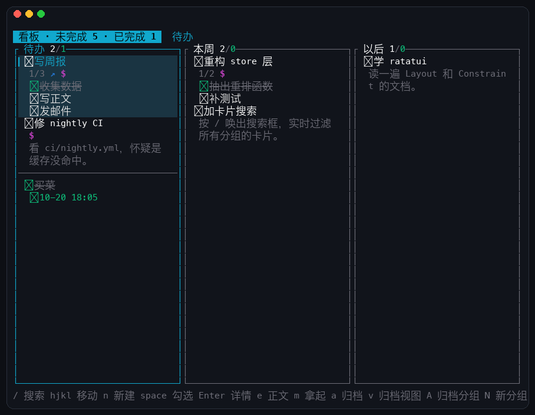
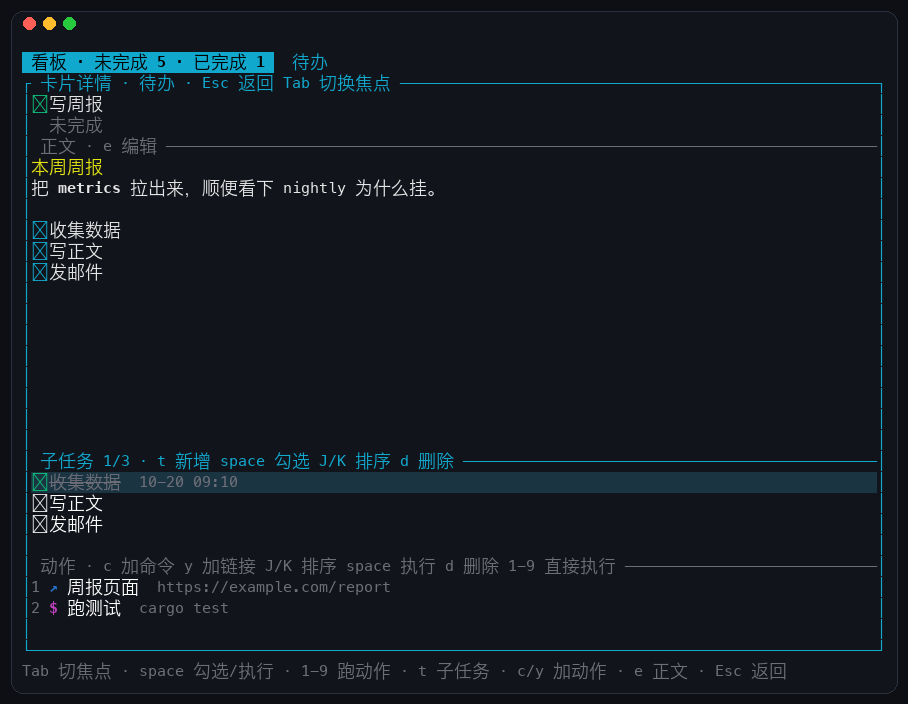
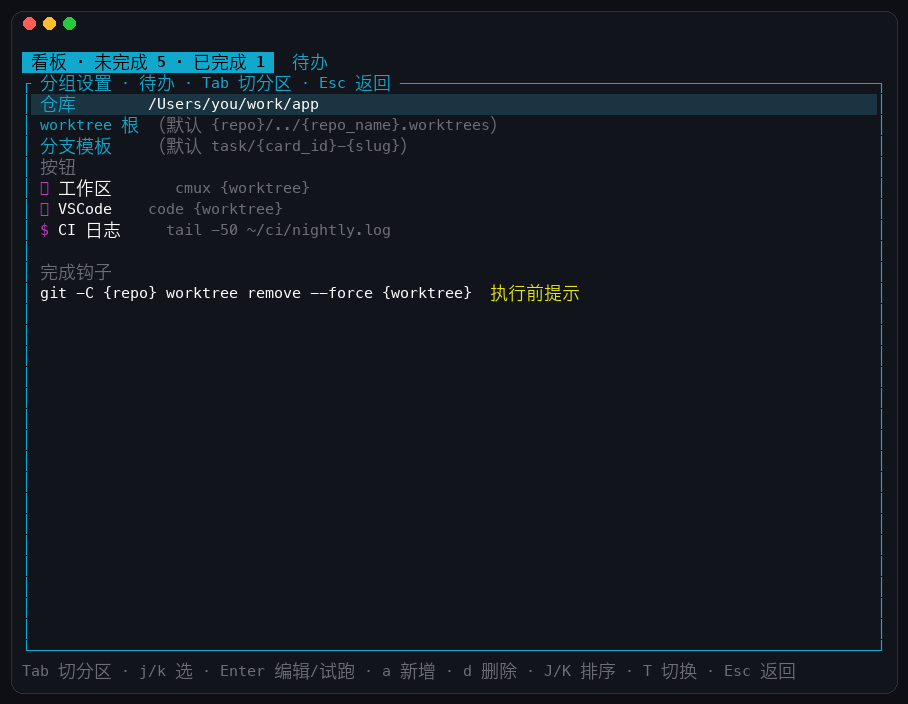
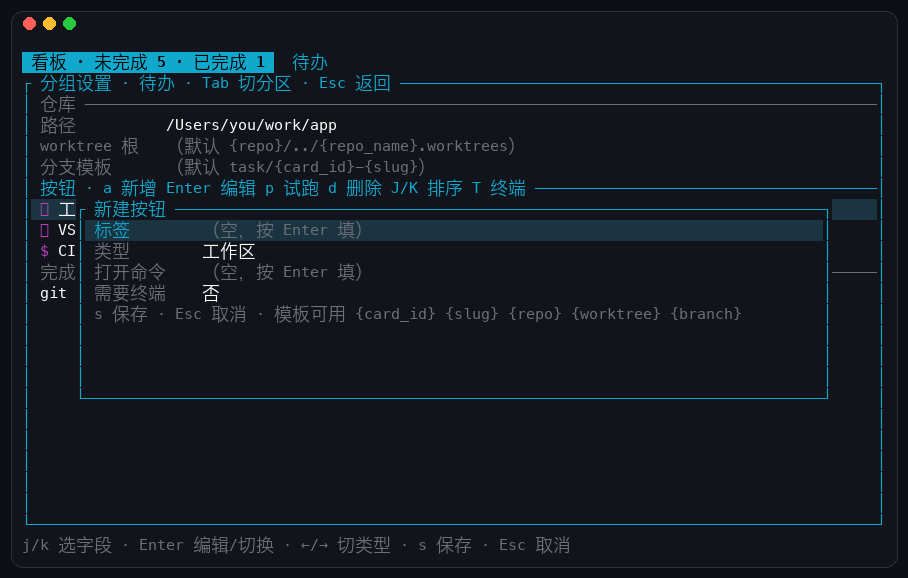

# term-kanban

单用户自用的终端任务看板。Rust + ratatui，数据落在本地 SQLite。



<sub>分组横向平铺；选中的卡片带竖条与整行底色；子任务直接外显在卡片正面，点复选框就能勾。</sub>



<sub>详情整屏：Markdown 正文、带完成时间的子任务、可执行的动作、关联与分组按钮。</sub>



<sub>`g` 打开分组设置：关联仓库、组内共享按钮、完成钩子。换 agent 只改一行模板。</sub>



<sub>按钮用表单填，四个字段各自独立——命令里可以写 shell 管道。</sub>

```
crates/
  kanban-core/   域模型 · 存储 · 动作执行。不含任何 ratatui 类型
  kanban-tui/    ratatui 渲染与输入（含拖拽状态机）
```

设计决定见 `CONTEXT.md`（术语）与 `docs/adr/`（架构决策）。

## 跑起来

```bash
cargo run --release
```

数据默认落在：

- macOS：`~/Library/Application Support/term-kanban/kanban.db`
- 其它：`$XDG_DATA_HOME/term-kanban/kanban.db`

用 `KANBAN_DB=/path/to/kanban.db` 可以指到别处。

数据库带版本号（`PRAGMA user_version`），启动时自动迁移；如果库是更新的程序写的，会拒绝启动而不是写坏它。

首次启动会建三个分组：待办 / 本周 / 以后。

## 概念（一句话版）

- **分组**是横向的列，只表示"属于哪个集合"，不表示进度。
- 每个分组内部被分隔线切成**未完成段**（你手动排序）和**已完成段**（按完成时间倒序）。
- 进度只有**勾选**这一个二值，勾上写完成时间，取消即清空并回到未完成段末尾。
- **子任务**是卡片里的一行检查项，清单直接显示在卡片正面（点 `☐` 就能勾），全勾上也不会自动勾父卡。勾掉后它的完成时间显示在详情里。有子任务时正面不再显示正文预览。
- **动作**是挂在卡片上的命令或链接。正面最多画 6 个图标（`$` 命令 / `↗` 链接），多出来的收成 `+N`；被标成「需要终端」的命令在详情里带一个 `⌨`。
- **分组按钮**配置在分组上，组内所有卡片自动获得（不复制到卡片）。三种：**工作区**（`⎇`，确保 worktree 存在再打开它）、命令（`$`）、链接（`↗`）。卡片正面用青色显示，和卡片自己的动作（品红/蓝）之间隔一个 `·`，点图标即执行。
- **工作区**是一张卡对应的一个 git worktree。位置和分支名由分组配置算出来，建好就登记，再点即复用。
- **钩子**绑在「勾成完成」这个事件上，执行一条模板命令，可以选择执行前是否提示。
- **关联**是两张独立卡片之间的关系（目前只有父子），可以跳转；它和卡内**子任务**是两件事。
- **归档**是个盖章动作，不传染：归档分组不动组内卡片，恢复即原样回来。
- 卡片没有删除键，**硬删除只在归档视图**里存在。

## 布局

各分组横向平铺：每栏最小 24 格，放得下几栏就放几栏，然后按栏数平分整个宽度（不留右侧空白）；放不下时才横向滚动（`H` `L`）。

分组内部纵向滚动，选中的卡永远在视口里；右下角的 `↓N` 表示下面还有几张。卡片只有一行的时候就是一行——没有进度、动作、完成时间，就不占第二行。

## 搜索

按 `/` 边打字边筛，命中标题、正文、子任务三处；没有命中的分组会暂时收起，顶栏显示「筛选「x」· N 张」。

- `Enter` 确定，筛选继续生效（可以接着编辑、拖拽命中的卡）
- `Esc` 取消并还原到搜索前的状态；在看板上按 `Esc` 也能清掉当前筛选

## 工作区与 agent

给分组关联一个本地 git 仓库，组内每张卡就多出一个**工作区按钮**：点一下自动建好该卡专属的 worktree 并交给你的 agent / 编辑器。

配置入口：在看板上按 `g`。三个字段 + 两张表：

| 字段 | 说明 | 默认 |
|---|---|---|
| 仓库 | 本地 git 仓库绝对路径（支持 `~/`） | 无 |
| worktree 根 | worktree 放在哪 | `{repo}/../{repo_name}.worktrees` |
| 分支模板 | 每张卡的分支名 | `task/{card_id}-{slug}` |

按钮与钩子都是**模板命令**，可用变量：`{card_id}` `{slug}` `{group}` `{repo}` `{repo_name}` `{worktree}` `{branch}`。

按钮在 `g` 面板里按 `a` 打开表单，四个字段各自独立填写：

| 字段 | 说明 |
|---|---|
| 标签 | 卡片上显示的名字 |
| 类型 | 工作区 / 命令 / 链接（`←/→` 切换） |
| 打开命令 / 命令 / URL | 随类型变化的模板 |
| 需要终端 | 命令类型才有，交互式程序要打开 |

因为字段是分开的，**命令里可以放心写 shell 管道**：

```
tail -50 app.log | grep ERROR
```

（早先用 `标签 | 类型 | 模板` 的单行写法，管道会被当成分隔符切掉——已废弃。）

模板示例：

```
工作区   cmux {worktree}
工作区   code {worktree}
命令     git -C {repo} worktree remove {worktree}
```

换工具只改这一行——代码里没有任何 `cmux` / `codex` / `code` 字样。`{title}` 只能用于显示，拼进命令会直接报错（要引用标题请用 `{slug}`）。

按 `w` 直接开当前卡的工作区；按 `W` 看所有活着的工作区（含未提交改动的 `●` 标记），在那里可以打开或删除。

**完成钩子**在卡片被勾成完成时触发；配置时默认要求确认，确认框会显示完整命令。删工作区前会检查未提交改动，有改动就拒绝（`W` 里删也一样）。

## 键位

### 看板

| 键 | 作用 |
|---|---|
| `h` `l` / `←` `→` | 换分组 |
| `j` `k` / `↑` `↓` | 组内上下选卡（会跨过分隔线进已完成段） |
| `H` `L` | 分组放不下时，左右滚动 |
| `Tab` | 折叠 / 展开已完成段 |
| `Enter` / 双击 | 打开卡片详情 |
| `g` | 分组设置（仓库 / 按钮 / 钩子） |
| `w` | 打开当前卡的工作区 |
| `W` | 工作区总览 |
| `/` | 搜索（标题 / 正文 / 子任务，边打边筛） |
| `Esc` | 有筛选时先清筛选，否则取消「拿起」状态 |
| `q` | 退出 |
| `n` | 新建卡片（追加到未完成段末尾） |
| `i` | 改标题 |
| `space` | 勾选 / 取消完成 |
| `e` | 用 `$EDITOR` 编辑正文（Markdown） |
| `m` | 拿起卡片，之后 `hjkl` 实时移动，`Enter` 放下 |
| `a` | 归档卡片 |
| `1`–`9` | 执行第 N 个动作 |
| `N` | 新建分组 |
| `R` | 改分组名 |
| `<` `>` | 分组左移 / 右移 |
| `A` | 归档整个分组 |
| `Backspace` | 删除空分组（非空的会提示先归档） |

### 卡片详情

| 键 | 作用 |
|---|---|
| `Tab` | 焦点循环：子任务 → 动作 → 关联 → 分组按钮 |
| `j` `k` | 焦点内上下 |
| `space` | 勾选子任务 / 执行选中的动作 |
| `t` | 新增子任务 |
| `J` `K` | 当前焦点内的子任务 / 动作上移下移 |
| `d` | 删除子任务 / 删除动作 |
| `c` | 新增命令动作 |
| `y` | 新增链接动作 |
| `T` | 切换选中动作的「需要终端」 |
| `1`–`9` | 执行第 N 个动作 |
| `r` | 新增关联（输入卡片编号或标题片段） |
| `space` | 焦点在关联上时跳转，在分组按钮上时执行 |
| `PageUp` `PageDown` | 滚动正文 |
| `e` | 编辑正文 |
| `Esc` | 返回看板 |

### 归档视图

| 键 | 作用 |
|---|---|
| `v` | 进入 / 退出 |
| `j` `k` | 选择 |
| `u` | 恢复选中的卡片或整个分组 |
| `x` | 彻底删除（不可恢复） |

### 分组设置（`g`）

| 键 | 作用 |
|---|---|
| `Tab` | 在「配置字段 / 按钮 / 钩子」之间切换 |
| `j` `k` | 选择 |
| `Enter` | 编辑字段；在按钮/钩子上为打开编辑表单 |
| `p` | 用组内第一张卡试跑选中的按钮 |
| `a` | 新增按钮或钩子 |
| `d` | 删除选中的按钮或钩子 |
| `J` `K` | 调整按钮顺序 |
| `T` | 切换「需要终端」 |

### 按钮 / 钩子编辑表单

| 键 | 作用 |
|---|---|
| `j` `k` | 在字段间移动 |
| `Enter` | 编辑文本字段 / 切换类型与开关 |
| `←` `→` | 切换按钮类型 |
| `s` | 保存（会先用假变量试渲染模板，拼错就报错并留在表单里） |
| `Esc` | 取消 |

### 工作区总览（`W`）

| 键 | 作用 |
|---|---|
| `j` `k` | 选择 |
| `Enter` | 打开（切到该卡并跑工作区按钮） |
| `d` | 删除工作区（有未提交改动会拒绝） |

### 鼠标

点卡片 = 选中；点卡片上的 `☐` = 勾选这张卡；点子任务行的 `☐` = 勾选那条子任务；点 `$` / `↗` = 执行动作；按住拖动 = 移动分组 / 组内排序；双击 = 打开详情；滚轮 = 上下选卡。

拖拽不能把卡片拖过「未完成 / 已完成」的分界线——改完成状态只能用勾选。

## 配置动作

在卡片详情里：

- `c` 加命令，输入格式 `标签 | shell 命令`，例如 `跑测试 | cargo test`
- `y` 加链接，输入格式 `标签 | URL`，例如 `周报页 | https://example.com`

命令的执行方式（见 ADR-0006）：

1. 看板收起，终端让给命令，输出原样可见；
2. 同时把完整输出写进日志文件、并记一条运行记录（启动时间、退出码）；
3. 跑完按回车返回看板。

新增动作时会按命令自动判断要不要终端：`ssh` / `vim` / `less` / `htop` / `tmux` / `psql` 这类，以及不带参数的 `python` / `node`（进 REPL）会自动标上；`sudo -u root htop` 这种带包装命令的也认得出来。判断错了按 `T` 手动切换。

日志在 `~/Library/Application Support/term-kanban/logs/`。

## 以后想加 Web 版

`kanban-core` 不认识 ratatui，所有变更都是意图式调用（`move_card(card_id, group_id, index)`）。加 Web 版时新增 `crates/kanban-server`（axum）把 core 包成 HTTP/JSON，TUI 一行不用改。

⚠️ 一旦对外暴露动作执行，必须只绑 `127.0.0.1` 并要求 token——**一个能跑 shell 的 HTTP 接口就是 RCE**。

## 截图怎么来的

截图不是抓屏，而是用 ratatui 的 `TestBackend` 把界面渲染到内存缓冲，再读每个格子画成图——比解析 ANSI 转义序列可靠（全角字符宽度、光标定位不会算歪），也不会因为换个终端就变样。

```shell
cd crates/kanban-tui
cargo run --example dump_screen -- /path/to/kanban.db 96 30 > /tmp/board.json
python3 ../../docs/make-screenshot.py /tmp/board.json ../../docs/screenshot.png
```

第五个参数是要先按的键（`\r` 回车、`\t` Tab、`\e` Esc），例如 `'\r'` 就能截详情页。
